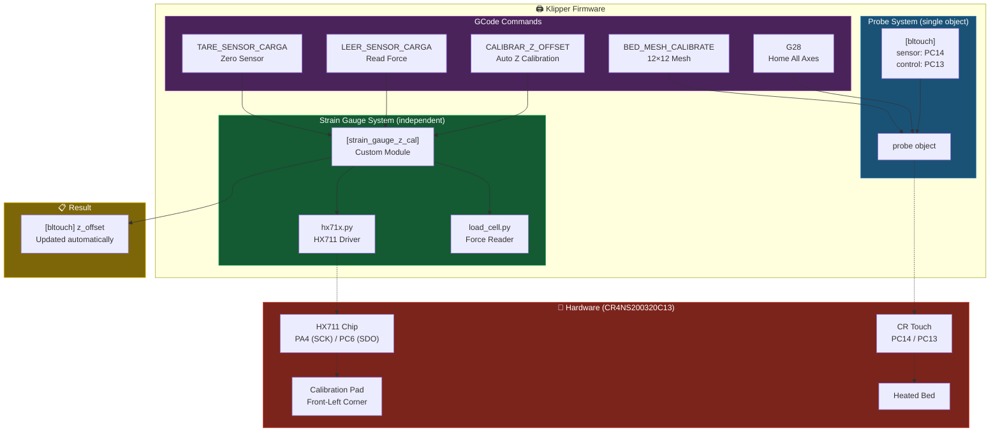
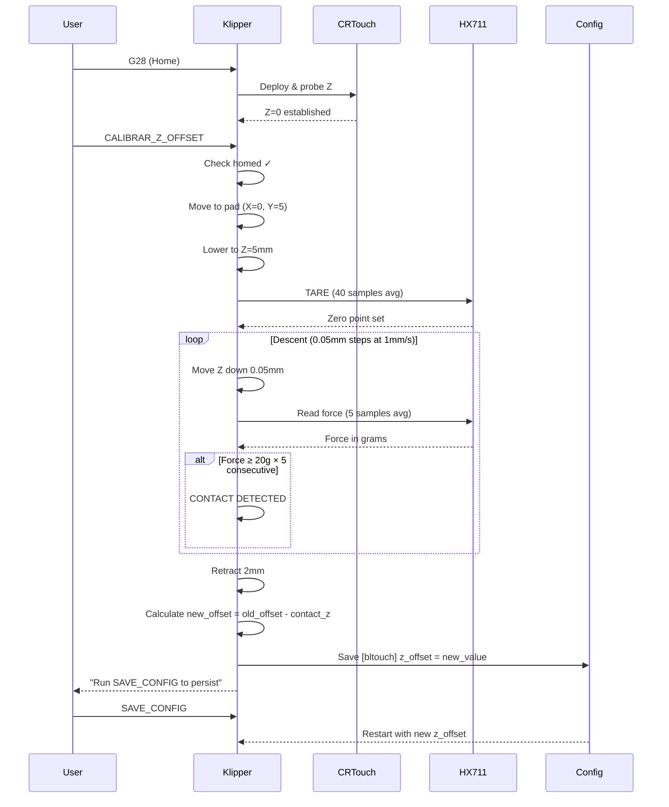

# Ender 3 V3 SE — HX711 Strain Gauge Z Offset Patch for Klipper

<p align="center">
  <b>Use the built-in HX711 pressure sensor on your Ender 3 V3 SE to auto-calibrate Z offset — without breaking G28, bed mesh, or your CR Touch.</b>
</p>

<p align="center">
  
  
  
  
</p>

---

## The Problem

The Ender 3 V3 SE has a **hidden HX711 strain gauge sensor** wired to the mainboard (pins PA4/PC6). Creality's stock Marlin firmware uses it for "Auto Z Offset" — the nozzle touches a calibration pad at the front-left corner and the pressure sensor detects contact to set Z=0 precisely.

When you switch to Klipper, **this sensor goes unused**. Klipper has a `[load_cell_probe]` module, but it registers itself as the `probe` object — and so does `[bltouch]`. **Klipper only allows ONE probe.** You can't use both.

This means you're forced to choose:
- ❌ Use CR Touch for everything → lose auto Z offset
- ❌ Use load_cell_probe for everything → lose reliable bed mesh and G28

## The Solution

This patch adds a **custom Klipper module** (`strain_gauge_z_cal.py`) that reads the HX711 sensor **without registering as a probe**. Both sensors coexist with zero conflicts:

- ✅ `G28` → works normally with CR Touch
- ✅ `BED_MESH_CALIBRATE` → works normally with CR Touch
- ✅ `CALIBRAR_Z_OFFSET` → **NEW** — uses the strain gauge to auto-calibrate Z offset
- ✅ Both sensors active simultaneously, zero conflicts

---

## Architecture



### Calibration Flow



---

## Requirements

- **Printer**: Creality Ender 3 V3 SE
- **Board**: CR4NS200320C13 (GD32F303RET6 / STM32F103 compatible)
- **Klipper**: v0.13.0 or newer (HX711 driver support required)
- **Existing config**: CR Touch / BLTouch already working with `[bltouch]` + `[safe_z_home]`
- **NumPy**: installed in klippy-env (usually already present)

---

## Installation — Step by Step

### Step 1: Update MCU Firmware to v0.13.0+

The HX711 driver was added in Klipper v0.13.0. If your MCU firmware is older, the sensor won't work.

**Check your current version** in `klippy.log`:
```
MCU 'mcu' config: ...version=v0.12.0-xxx  ← TOO OLD
MCU 'mcu' config: ...version=v0.13.0-xxx  ← OK ✅
```

**If you need to update:**

```bash
cd ~/klipper
make menuconfig
```

| Setting | Value |
|---------|-------|
| Micro-controller Architecture | **STM32** |
| Processor model | **STM32F103** |
| Bootloader offset | **28KiB bootloader** |
| Clock Reference | **8 MHz crystal** |
| Communication interface | **Serial (on USART1 PA9/PA10)** |
| Enable extra low-level configuration options | **Yes** |
| Disable SWD on startup | **Yes** |

```bash
make clean && make
# Firmware binary: ~/klipper/out/klipper.bin
```

**Flash via SD card:**
1. Format a USB/SD card as **FAT32**
2. Copy `~/klipper/out/klipper.bin` to the card
3. **Rename it** to something unique (e.g., `firmware_v13.bin`) — filename must differ from last flash
4. Power off printer → insert card → power on
5. Wait ~10 seconds → remove card
6. Restart Klipper: `sudo systemctl restart klipper`

**Verify:**
```bash
grep "MCU 'mcu' config" ~/printer_data/logs/klippy.log | tail -1
# Should show version=v0.13.0-xxx
```

> ⚠️ The Ender 3 V3 SE uses a GD32F303RET6 chip, not genuine STM32F103. They are instruction-compatible — the STM32F103 firmware works correctly. Always use SD card flash method.

---

### Step 2: Install the Module

```bash
cp strain_gauge_z_cal.py ~/klipper/klippy/extras/
```

Or clone this repo and copy:
```bash
git clone https://github.com/YOUR_USER/ender3-v3se-strain-gauge-klipper.git
cp ender3-v3se-strain-gauge-klipper/strain_gauge_z_cal.py ~/klipper/klippy/extras/
```

---

### Step 3: Add to printer.cfg

Add this section **after** your `[bltouch]` block:

```ini
# Strain Gauge Z Offset Calibration (HX711 at front-left corner pad)
# Uses the load cell sensor independently from bltouch for Z offset only
[strain_gauge_z_cal]
sensor_type: hx711
dout_pin: PC6
sclk_pin: PA4
sample_rate: 80
gain: A-128
pad_x: 0                         # X position of calibration pad
pad_y: 5                         # Y position of calibration pad
z_start_height: 5.0
z_min_position: -2.0
force_threshold: 20.0
step_size: 0.05
speed: 1.0
retract_dist: 2.0
clearance_z: 10.0
travel_speed: 80.0
target_probe_section: bltouch
counts_per_gram: 124.52113
reference_tare_counts: 403946
```

> ⚠️ **`pad_x` / `pad_y`**: Machine coordinates of the calibration pad. Move nozzle manually to the pad center and note coordinates. Values above are estimates.

> ⚠️ **`counts_per_gram` / `reference_tare_counts`**: HX711 calibration. Values shown are from our test unit. See [Sensor Calibration](#sensor-calibration).

**Your existing `[bltouch]`, `[safe_z_home]`, and `[bed_mesh]` remain UNCHANGED.**

---

### Step 4: Add Macros

Add to `macro.cfg` or `printer.cfg`:

```ini
[gcode_macro CALIBRAR_Z_OFFSET]
description: Auto-calibrate Z offset using the strain gauge corner pad
gcode:
    STRAIN_GAUGE_CALIBRATE_Z

[gcode_macro LEER_SENSOR_CARGA]
description: Read current force from HX711 sensor (diagnostic)
gcode:
    STRAIN_GAUGE_READ

[gcode_macro TARE_SENSOR_CARGA]
description: Tare (zero) the HX711 sensor
gcode:
    STRAIN_GAUGE_TARE
```

---

### Step 5: Restart and Verify

```bash
sudo systemctl restart klipper
```

Check `klippy.log` for:
```
strain_gauge_z_cal: initialized (pad at X=0.0 Y=5.0)
```

---

## Usage

```gcode
G28                    ; Home all axes (CR Touch — normal)
CALIBRAR_Z_OFFSET      ; Auto-calibrate Z offset (strain gauge)
SAVE_CONFIG            ; Save permanently
```

Console output:
```
=== Z OFFSET CALIBRATION (Strain Gauge) ===
Moving to strain gauge pad at X=0.0 Y=5.0...
Taring strain gauge sensor...
Tare complete: counts=403946 (4.82%)
Starting Z probe descent (threshold=20.0g, step=0.050mm)...
Contact detected! Force=23.4g at Z=0.1250
=== CALIBRATION RESULT ===
Contact Z position: 0.1250
Previous Z offset: 1.0000
New Z offset: 0.8750
Saving to [bltouch] z_offset...
Z offset saved! Run SAVE_CONFIG to make it permanent.
=== CALIBRATION COMPLETE ===
```

---

## Sensor Calibration

The HX711 needs `reference_tare_counts` (zero point) and `counts_per_gram` (scale factor).

### Quick Start
The defaults (`counts_per_gram: 124.52113`, `reference_tare_counts: 403946`) work as a starting point. The auto-tare during calibration compensates for drift.

### Precise Calibration
1. `TARE_SENSOR_CARGA` with nothing touching pad → note `counts` → set as `reference_tare_counts`
2. Place known weight (200g+) on pad
3. `LEER_SENSOR_CARGA` → note raw counts
4. `counts_per_gram = (loaded_counts - tare_counts) / weight_grams`
5. Update in `printer.cfg` → `SAVE_CONFIG`

---

## Configuration Reference

| Parameter | Default | Description |
|-----------|---------|-------------|
| `sensor_type` | — | `hx711`, `hx717`, or `ads1220` |
| `dout_pin` | — | HX711 data pin (`PC6` on V3 SE) |
| `sclk_pin` | — | HX711 clock pin (`PA4` on V3 SE) |
| `sample_rate` | `80` | Hz (80 or 10) |
| `gain` | `A-128` | `A-128`, `B-32`, `A-64` |
| `pad_x` | `0` | Calibration pad X coordinate |
| `pad_y` | `5` | Calibration pad Y coordinate |
| `z_start_height` | `5.0` | Descent start height (mm) |
| `z_min_position` | `-2.0` | Safety limit (mm) |
| `force_threshold` | `20.0` | Contact detection force (grams) |
| `step_size` | `0.05` | Descent step (mm) |
| `speed` | `1.0` | Descent speed (mm/s) |
| `retract_dist` | `2.0` | Post-contact retract (mm) |
| `clearance_z` | `10.0` | Safe travel height (mm) |
| `travel_speed` | `80.0` | XY travel speed (mm/s) |
| `target_probe_section` | `bltouch` | Config section for z_offset |
| `counts_per_gram` | — | HX711 scale factor |
| `reference_tare_counts` | — | HX711 tare reference |

---

## Troubleshooting

| Error | Cause | Fix |
|-------|-------|-----|
| `Unknown command: hx71x_*` | MCU firmware < v0.13.0 | Flash firmware (Step 1) |
| Module not loading | .py not in extras/ | Copy to `~/klipper/klippy/extras/` |
| `Load cell not calibrated` | Missing calibration values | Set `counts_per_gram` + `reference_tare_counts` |
| `Z min position reached` | Wrong pad coords or high threshold | Adjust `pad_x`/`pad_y`, lower `force_threshold` |
| Conflicts with `[load_cell_probe]` | Both use HX711 | Remove `[load_cell_probe]` — this module replaces it |

---

## Hardware Pin Reference

### CR4NS200320C13 Board

| Component | Pin(s) |
|-----------|--------|
| HX711 Clock | PA4 |
| HX711 Data | PC6 |
| CR Touch Sensor | PC14 |
| CR Touch Servo | PC13 |
| X Endstop | PA5 |
| Y Endstop | PA6 |
| Z Endstop (no probe) | PA15 |

Source: [CrealityOfficial/Ender-3V3-SE](https://github.com/CrealityOfficial/Ender-3V3-SE) → `pins_CREALITY_V3_GD303.h`

---

## License

GNU GPLv3 — matching Klipper's license.

## Credits

- Pin mapping from [CrealityOfficial/Ender-3V3-SE](https://github.com/CrealityOfficial/Ender-3V3-SE) Marlin source
- Built on [Klipper3D](https://www.klipper3d.org/) HX711/load_cell infrastructure
- Developed and tested on Raspberry Pi 4 + Fluidd
