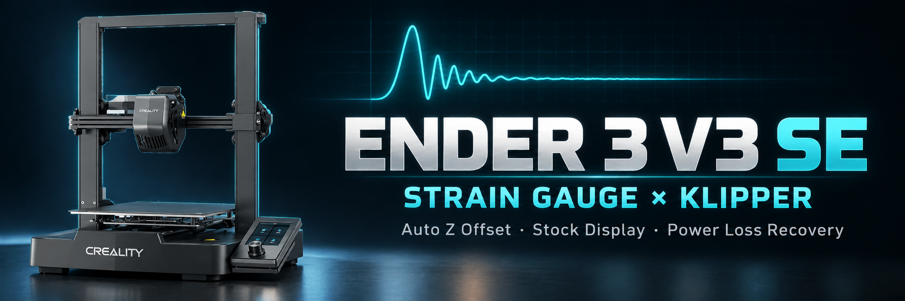
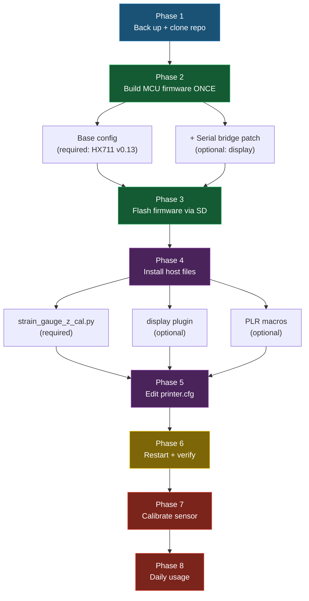
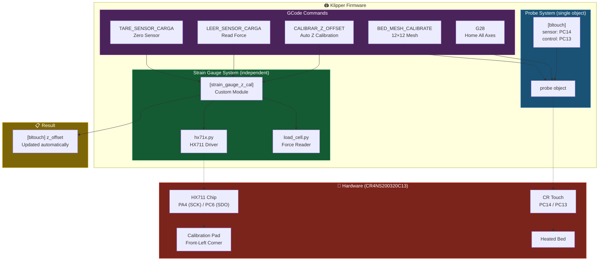
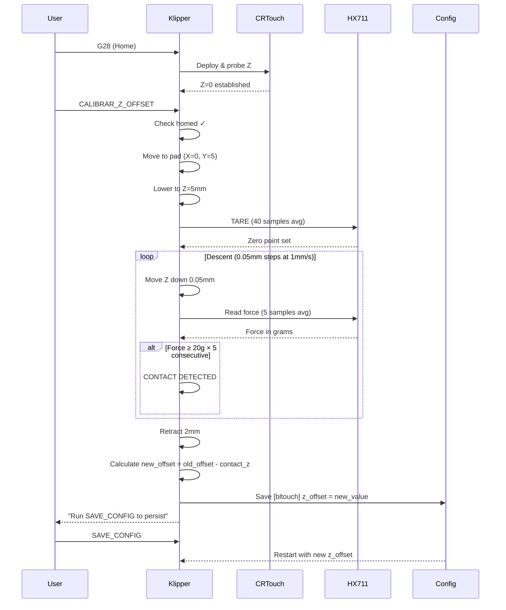

<p align="center">
  
</p>

# Ender 3 V3 SE — HX711 Strain Gauge + Display + PLR for Klipper

<p align="center">
  <b>A complete, step-by-step manual to bring the Ender 3 V3 SE's hidden strain gauge Z calibration, stock display, and Power Loss Recovery back to life under Klipper — all coexisting with CR&nbsp;Touch.</b>
</p>

<p align="center">
  
  
  
  
</p>

---

## ✅ What you'll have when you finish

| Feature | Result | Required? |
|---------|--------|-----------|
| HX711 strain gauge Z calibration | `CALIBRAR_Z_OFFSET` auto-sets Z offset, coexists with CR Touch | **Core** |
| Stock TJC display under Klipper | Live Z height, temp graph, menus | Optional |
| Power Loss Recovery (PLR) | Resume a print after a power cut without re-homing Z | Optional |

> This README is written as a **manual**: follow the phases in order. The **Core** path (strain gauge) is self-contained. The display and PLR are optional add-ons that fold into the same firmware build and config — you can add them now or later.

---

## 🗺️ Implementation roadmap

Read this once before you start. The single most important thing to understand: **you build and flash the MCU firmware only ONCE**, even if you want all three features. The strain gauge needs Klipper ≥ v0.13.0 (HX711 driver); the display needs the serial-bridge patch. Both go into the *same* firmware build.



**Time budget:** ~30 min for the core path; +20 min if you add the display; +10 min for PLR.

---

## 📋 Phase 0 — Before you start

Check every box before touching anything:

- [ ] **Printer**: Creality Ender 3 V3 SE
- [ ] **Board**: CR4NS200320C13 (GD32F303RET6 — STM32F103-compatible)
- [ ] **Klipper host** already installed and running (Raspberry Pi, tested on Pi 4 + Fluidd)
- [ ] **CR Touch / BLTouch already working** — you have a functioning `[bltouch]` + `[safe_z_home]` + `[bed_mesh]` in `printer.cfg`
- [ ] **NumPy** present in klippy-env (it normally is)
- [ ] You can flash MCU firmware via **SD card** (you'll need a FAT32 SD/USB card)

**Decide your path now:**

- [ ] I want the **strain gauge** (Core) — *everyone does Phases 1–8*
- [ ] I also want the **stock display** — *do the `+ display` sub-steps in Phases 2, 4, 5*
- [ ] I also want **PLR** — *do the `+ PLR` sub-steps in Phases 4, 5*

> ⚠️ **Why this matters:** the strain gauge and the display are wired to the same MCU. If you build firmware twice (once for each), you waste time and risk a half-configured board. Decide now so you compile once.

---

## Phase 1 — Back up and get the files

```bash
# 1. Back up your working config and current firmware
cp ~/printer_data/config/printer.cfg ~/printer.cfg.bak

# 2. Clone this repo onto the Pi
cd ~
git clone https://github.com/elisaul77/ender3-v3se-strain-gauge-klipper.git
cd ender3-v3se-strain-gauge-klipper
```

> 💡 Keep `~/printer.cfg.bak`. If anything goes wrong, restoring it + reflashing your old firmware gets you back to a working printer.

✅ **Checkpoint:** you have the repo at `~/ender3-v3se-strain-gauge-klipper` and a config backup.

---

## Phase 2 — Build the MCU firmware (do this ONCE)

The HX711 strain-gauge driver was added in Klipper **v0.13.0**. First check whether your MCU is already on v0.13.0+:

```bash
grep "MCU 'mcu' config" ~/printer_data/logs/klippy.log | tail -1
# version=v0.12.0-xxx  → TOO OLD, rebuild below
# version=v0.13.0-xxx  → base is OK (you still need the patch if you want the display)
```

If you only want the strain gauge **and** you're already on v0.13.0+, you can skip to **Phase 4**. Otherwise, build now.

### 2a. Base configuration (required)

```bash
cd ~/klipper
make menuconfig
```

| Setting | Value |
|---------|-------|
| Micro-controller Architecture | **STM32** |
| Processor model | **STM32F103** |
| Bootloader offset | **28KiB bootloader** |
| Clock Reference | **8 MHz crystal** |
| Communication interface | **Serial (on USART1 PA9/PA10)** |
| Enable extra low-level configuration options | **Yes** |
| Disable SWD on startup | **Yes** |

> ⚠️ The V3 SE uses a **GD32F303RET6**, not a genuine STM32F103. They are instruction-compatible — the STM32F103 firmware runs correctly. Always flash via SD card (never SWD/DFU).

### 2b. `+ display` — add the serial-bridge patch (optional)

Do this **before compiling** if you want the stock display. It lets the same firmware talk to the TJC display over USART2 while keeping the HX711 working.

```bash
# Copy the MCU patch sources into Klipper
cp ~/ender3-v3se-strain-gauge-klipper/klipper_patches/src/serial_bridge.c        ~/klipper/src/
cp ~/ender3-v3se-strain-gauge-klipper/klipper_patches/src/dirzctl.c              ~/klipper/src/
cp ~/ender3-v3se-strain-gauge-klipper/klipper_patches/src/stm32/serial_bridge.c  ~/klipper/src/stm32/
```

Edit `~/klipper/src/Makefile`:

```makefile
# Add this line near the top, before the other src- entries:
src-$(CONFIG_SERIAL_BRIDGE) += serial_bridge.c

# Find the existing line that lists trsync.c and append dirzctl.c:
#   before:  ... trsync.c
#   after:   ... trsync.c dirzctl.c
```

Then re-run `make menuconfig` and additionally enable:

| Setting | Value |
|---------|-------|
| Serial Bridge | **Enabled** |
| Serial Bridge USART | **USART2 (PA3/PA2)** |

> 📌 **Heads-up:** depending on your Klipper revision the build may also expect `src/stm32/serial_bridge.h`. That header is **not** bundled in this repo. If `make` complains about a missing `serial_bridge.h`, grab it from the upstream display project ([jpcurti/ender3-v3-se-klipper-with-display](https://github.com/jpcurti/ender3-v3-se-klipper-with-display)). Full patch notes: [`klipper_patches/INSTALL.md`](klipper_patches/INSTALL.md).

### 2c. Compile

```bash
cd ~/klipper
make clean && make
# Output binary: ~/klipper/out/klipper.bin
```

✅ **Checkpoint:** `~/klipper/out/klipper.bin` exists. Move on to flashing.

---

## Phase 3 — Flash the firmware via SD card

1. Format a USB/SD card as **FAT32**
2. Copy `~/klipper/out/klipper.bin` onto the card
3. **Rename it** to a *unique* filename (e.g. `firmware_v13.bin`) — it must differ from the last filename you flashed, or the bootloader ignores it
4. Power **off** the printer → insert card → power **on**
5. Wait ~10 seconds → power off → remove card
6. Restart Klipper:

```bash
sudo systemctl restart klipper
```

**Verify the flash took:**

```bash
grep "MCU 'mcu' config" ~/printer_data/logs/klippy.log | tail -1
# Must now show version=v0.13.0-xxx
```

If you applied the `+ display` patch, also verify the bridge registered:

```bash
grep "Serial bridge" ~/printer_data/logs/klippy.log | tail -1
# Serial bridge: available configs for mcu: SERIAL_BRIDGE_CONFIG_USART2_PA3,PA2=3
```

✅ **Checkpoint:** firmware reports v0.13.0+ (and the serial bridge line, if you added the display).

---

## Phase 4 — Install host-side files

### 4a. Strain gauge module (required)

```bash
cp ~/ender3-v3se-strain-gauge-klipper/strain_gauge_z_cal.py ~/klipper/klippy/extras/
```

### 4b. `+ display` — display plugin (optional)

```bash
cp ~/ender3-v3se-strain-gauge-klipper/klippy_extras/e3v3se_display.py ~/klipper/klippy/extras/
```

> ⚠️ **Important — the display plugin is not standalone.** `e3v3se_display.py` imports several companion modules that are **not bundled here**: `serial_bridge.py`, `TJC3224.py`, `printerInterface.py`, and the `display/menu_keys.py` package. Install the **upstream display plugin first** from [jpcurti/ender3-v3-se-klipper-with-display](https://github.com/jpcurti/ender3-v3-se-klipper-with-display), then copy this repo's `e3v3se_display.py` over the top (it's the version tuned to coexist with the strain gauge). Without those upstream files, Klipper will fail to load `[e3v3se_display]`.

### 4c. `+ PLR` — Power Loss Recovery macros (optional)

The PLR macros live in [`config/macro.cfg`](config/macro.cfg) under the `# POWER LOSS RECOVERY (PLR)` section. Either copy that whole file into your config, or paste the PLR section into your existing macros file. You'll also add a `[save_variables]` block in Phase 5.

✅ **Checkpoint:** the right `.py` files are in `~/klipper/klippy/extras/`.

---

## Phase 5 — Edit `printer.cfg`

Add the blocks below. **Your existing `[bltouch]`, `[safe_z_home]`, and `[bed_mesh]` stay UNCHANGED** — nothing about your CR Touch setup is touched.

### 5a. Strain gauge (required) — add **after** your `[bltouch]` block

```ini
# Strain Gauge Z Offset Calibration (HX711 at front-left corner pad)
# Reads the load cell independently of bltouch — for Z offset only.
[strain_gauge_z_cal]
sensor_type: hx711
dout_pin: PC6
sclk_pin: PA4
sample_rate: 80
gain: A-128
pad_x: 0                         # X of calibration pad (machine coords) — VERIFY for your unit
pad_y: 5                         # Y of calibration pad (machine coords) — VERIFY for your unit
z_start_height: 5.0
z_min_position: -2.0
force_threshold: 20.0
step_size: 0.05
speed: 1.0
retract_dist: 2.0
clearance_z: 10.0
travel_speed: 80.0
target_probe_section: bltouch
counts_per_gram: 124.52113       # HX711 scale — defaults from our test unit
reference_tare_counts: 403946    # HX711 tare — defaults from our test unit
```

> ⚠️ **`pad_x` / `pad_y`** are the machine coordinates of the calibration pad (front-left corner). Jog the nozzle manually over the pad center, note the coordinates, and set them here. The values above are estimates.

A ready-to-paste copy lives in [`config/strain_gauge_z_cal.cfg`](config/strain_gauge_z_cal.cfg).

### 5b. Macros (required) — register the friendly commands

```ini
[gcode_macro CALIBRAR_Z_OFFSET]
description: Auto-calibrate Z offset using the strain gauge corner pad
gcode:
    STRAIN_GAUGE_CALIBRATE_Z

[gcode_macro LEER_SENSOR_CARGA]
description: Read current force from HX711 sensor (diagnostic)
gcode:
    STRAIN_GAUGE_READ

[gcode_macro TARE_SENSOR_CARGA]
description: Tare (zero) the HX711 sensor
gcode:
    STRAIN_GAUGE_TARE
```

### 5c. `+ display` (optional)

```ini
[e3v3se_display]
language: 6       # English = library 6 on this firmware (NOT 4 as upstream expects)
logging: False

[force_move]      # Required for SET_KINEMATIC_POSITION (also used by PLR)
```

> ⚠️ **`language: 6`** — the stock Creality firmware stores its icon libraries at different positions than the plugin default (`4`). Library `6` = English. If your screen shows Chinese, test values 1–9 with the plugin's built-in `ICON_FINDER`.

### 5d. `+ PLR` (optional)

```ini
[save_variables]
filename: ~/printer_2_data/config/variables.cfg   # adjust path to your data dir
```

(And make sure the PLR macros from Phase 4c are included. PLR also relies on the `[force_move]` block above.)

✅ **Checkpoint:** `printer.cfg` has the blocks for every feature you chose.

---

## Phase 6 — Restart and verify

```bash
sudo systemctl restart klipper
```

Check `~/printer_data/logs/klippy.log` for the line(s) matching what you installed:

| You installed | Look for in klippy.log |
|---------------|------------------------|
| Strain gauge (always) | `strain_gauge_z_cal: initialized (pad at X=0.0 Y=5.0)` |
| Display | `[e3v3se_display]` loads with no traceback; screen lights up |
| PLR | No errors on `[save_variables]` / `[force_move]` |

If Klipper throws an error on restart, the message names the failing section — jump to [Troubleshooting](#-troubleshooting).

✅ **Checkpoint:** Klipper restarts clean and the init line(s) appear.

---

## Phase 7 — Calibrate the strain gauge

The HX711 needs two numbers: `reference_tare_counts` (zero point) and `counts_per_gram` (scale). The repo defaults are a working starting point and the auto-tare during calibration compensates for drift — but a one-time precise calibration is worth it.

### Quick start
Leave the defaults. The auto-tare on each `CALIBRAR_Z_OFFSET` run handles drift. Go to Phase 8 and try it.

### Precise calibration (recommended once)
1. With **nothing** touching the pad: `TARE_SENSOR_CARGA` → note the reported `counts` → set it as `reference_tare_counts`
2. Place a **known weight** (200 g+) on the pad
3. `LEER_SENSOR_CARGA` → note the raw counts
4. Compute: `counts_per_gram = (loaded_counts − tare_counts) / weight_grams`
5. Update both values in `printer.cfg` → `SAVE_CONFIG`

✅ **Checkpoint:** `LEER_SENSOR_CARGA` reports a sensible force, and zero with nothing on the pad.

---

## Phase 8 — Daily usage

```gcode
G28                    ; Home all axes (CR Touch — normal)
CALIBRAR_Z_OFFSET      ; Auto-calibrate Z offset using the strain gauge
SAVE_CONFIG            ; Persist the new offset
```

Expected console output:

```
=== Z OFFSET CALIBRATION (Strain Gauge) ===
Moving to strain gauge pad at X=0.0 Y=5.0...
Taring strain gauge sensor...
Tare complete: counts=403946 (4.82%)
Starting Z probe descent (threshold=20.0g, step=0.050mm)...
Contact detected! Force=23.4g at Z=0.1250
=== CALIBRATION RESULT ===
Contact Z position: 0.1250
Previous Z offset: 1.0000
New Z offset: 0.8750
Saving to [bltouch] z_offset...
Z offset saved! Run SAVE_CONFIG to make it permanent.
=== CALIBRATION COMPLETE ===
```

**If you installed PLR:** after a power cut, once Klipper is ready again, run:

```gcode
PLR_RESUME
```

It homes only X/Y, restores the Z position via `SET_KINEMATIC_POSITION` (no Z re-home, so it won't crash into the printed part), and resumes the file from the exact byte position.

🎉 **Done.** You now have strain-gauge Z calibration (plus any add-ons you chose) running alongside CR Touch.

---
---

# 📖 Reference

Everything below is background and lookup material — you don't need to read it to install.

## Why this exists — the problem and the fix

The Ender 3 V3 SE has a **hidden HX711 strain gauge** wired to the mainboard (pins PA4/PC6). Stock Marlin uses it for "Auto Z Offset": the nozzle touches a pad at the front-left corner and the pressure sensor detects contact to set Z=0.

Under Klipper this sensor goes unused. Klipper has a `[load_cell_probe]` module, but it registers itself as the `probe` object — and so does `[bltouch]`. **Klipper allows only ONE probe.** So you'd be forced to choose:

- ❌ CR Touch for everything → lose auto Z offset
- ❌ load_cell_probe for everything → lose reliable bed mesh and G28

**The fix:** `strain_gauge_z_cal.py` reads the HX711 **without registering as a probe**. Both sensors coexist:

- ✅ `G28` → CR Touch, normal
- ✅ `BED_MESH_CALIBRATE` → CR Touch, normal
- ✅ `CALIBRAR_Z_OFFSET` → **new** — strain gauge auto-calibrates Z offset
- ✅ Both active at once, zero conflicts

## How it works — architecture



### Calibration flow



### How PLR works
- `PLR_SAVE_TIMER` runs a self-sustaining loop every 30s from Klipper startup
- It saves: filename, byte position in the G-code, Z height, temperatures, fan, speed
- On resume: homes only X/Y, restores Z via `SET_KINEMATIC_POSITION` (requires `[force_move]`)
- Resumes the file from the exact byte position with `M23` + `M26` + `M24`

## Configuration reference — `[strain_gauge_z_cal]`

| Parameter | Default | Description |
|-----------|---------|-------------|
| `sensor_type` | — | `hx711`, `hx717`, or `ads1220` |
| `dout_pin` | — | HX711 data pin (`PC6` on V3 SE) |
| `sclk_pin` | — | HX711 clock pin (`PA4` on V3 SE) |
| `sample_rate` | `80` | Hz (80 or 10) |
| `gain` | `A-128` | `A-128`, `B-32`, `A-64` |
| `pad_x` | `0` | Calibration pad X coordinate |
| `pad_y` | `5` | Calibration pad Y coordinate |
| `z_start_height` | `5.0` | Descent start height (mm) |
| `z_min_position` | `-2.0` | Safety limit (mm) |
| `force_threshold` | `20.0` | Contact detection force (grams) |
| `step_size` | `0.05` | Descent step (mm) |
| `speed` | `1.0` | Descent speed (mm/s) |
| `retract_dist` | `2.0` | Post-contact retract (mm) |
| `clearance_z` | `10.0` | Safe travel height (mm) |
| `travel_speed` | `80.0` | XY travel speed (mm/s) |
| `target_probe_section` | `bltouch` | Config section that receives z_offset |
| `counts_per_gram` | — | HX711 scale factor |
| `reference_tare_counts` | — | HX711 tare reference |

## 🔧 Troubleshooting

| Symptom | Cause | Fix |
|---------|-------|-----|
| `Unknown command: hx71x_*` | MCU firmware < v0.13.0 | Rebuild + reflash (Phase 2–3) |
| `strain_gauge_z_cal` module not loading | `.py` not in extras | Copy to `~/klipper/klippy/extras/` (Phase 4a) |
| `Load cell not calibrated` | Missing calibration values | Set `counts_per_gram` + `reference_tare_counts` (Phase 7) |
| `Z min position reached` | Wrong pad coords or threshold too high | Fix `pad_x`/`pad_y`, lower `force_threshold` |
| Conflicts with `[load_cell_probe]` | Both use the HX711 | Remove `[load_cell_probe]` — this module replaces it |
| `[e3v3se_display]` fails to load | Missing upstream companion files | Install the upstream display plugin first (Phase 4b) |
| `make` can't find `serial_bridge.h` | Header not bundled | Get it from the upstream display repo (Phase 2b) |
| Display shows Chinese | Wrong icon library | Try `language:` 1–9; use `ICON_FINDER` |
| PLR resume crashes Z into part | `[force_move]` missing | Add `[force_move]` (Phase 5c) |

## Hardware pin reference — CR4NS200320C13

| Component | Pin(s) |
|-----------|--------|
| HX711 Clock | PA4 |
| HX711 Data | PC6 |
| CR Touch Sensor | PC14 |
| CR Touch Servo | PC13 |
| Display (TJC3224_011N) | USART2 — TX PA2 / RX PA3 |
| X Endstop | PA5 |
| Y Endstop | PA6 |
| Z Endstop (no probe) | PA15 |

Source: [CrealityOfficial/Ender-3V3-SE](https://github.com/CrealityOfficial/Ender-3V3-SE) → `pins_CREALITY_V3_GD303.h`

## Repository layout

| Path | What it is |
|------|-----------|
| `strain_gauge_z_cal.py` | The custom Klipper module (Phase 4a) |
| `config/strain_gauge_z_cal.cfg` | Ready-to-paste `[strain_gauge_z_cal]` block |
| `config/macro.cfg` | Macros incl. the PLR section (Phase 4c) |
| `config/printer.cfg`, `config/macros.cfg` | Reference full configs from the test machine |
| `klipper_patches/` | MCU serial-bridge patch for the display + `INSTALL.md` |
| `klippy_extras/e3v3se_display.py` | Display plugin (needs upstream companions — Phase 4b) |

---

## License

GNU GPLv3 — matching Klipper's license.

## Credits

- Display plugin based on [jpcurti/ender3-v3-se-klipper-with-display](https://github.com/jpcurti/ender3-v3-se-klipper-with-display)
- Pin mapping from [CrealityOfficial/Ender-3V3-SE](https://github.com/CrealityOfficial/Ender-3V3-SE) Marlin source
- Built on [Klipper3D](https://www.klipper3d.org/) HX711/load_cell infrastructure
- Developed and tested on Raspberry Pi 4 + Fluidd
